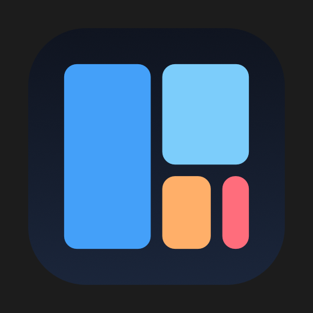
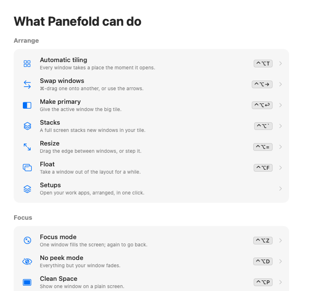
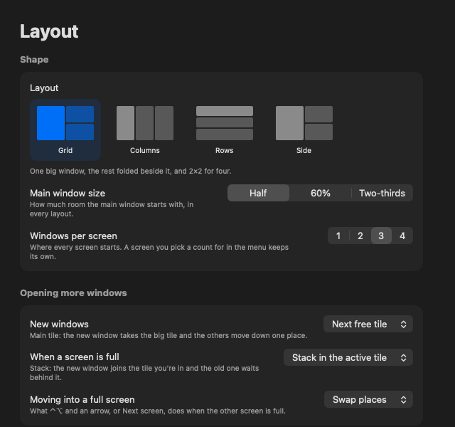
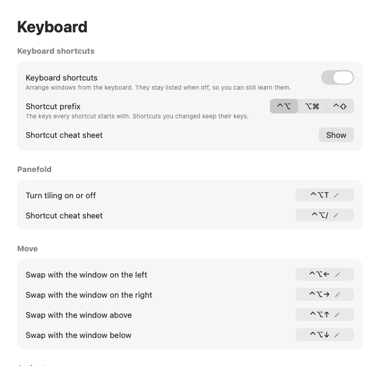
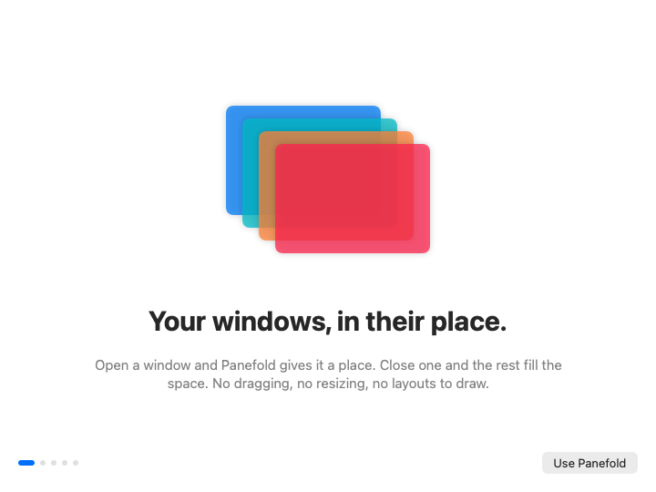
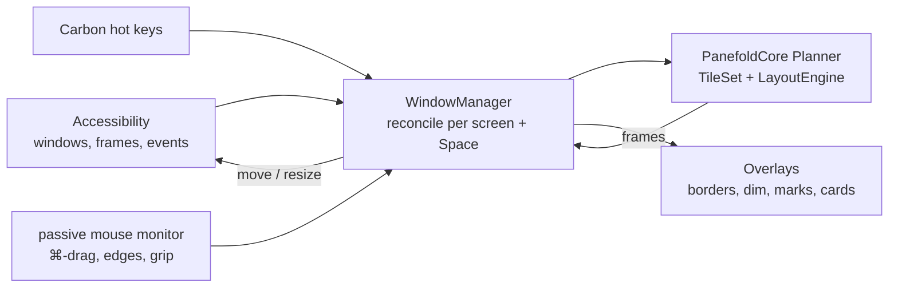

<div align="center">



# Panefold

**Every window in its place, without dragging a thing.**

A native macOS window manager for the menu bar. Open a window and it takes a place on
the screen; close one and the others fill the space. Layouts per screen, stacks when a
screen is full, focus modes for calls and screen sharing. No Electron, no account, no
telemetry.

[](https://github.com/mralifakbar/panefold/releases/latest)


[](LICENSE)



</div>

## Features

### Tiling that keeps itself tidy

- **Windows place themselves** — a new window takes the next tile, a closed one leaves
  no hole. Each new window takes half of the newest space, so you always know where
  the next one goes.
- **Four layouts** — Grid, Columns, Rows and Side, 1 to 4 windows per screen. Ultrawide
  monitors keep two big windows and a narrow column; vertical monitors put the big
  window on top. Up to 5 windows on both.
- **Per screen and per Space** — each screen keeps its own layout, window count, order
  and sizes, and remembers them after restarts and reconnects.
- **Main window size** — the primary window gets half, 60% or two-thirds.
- **Stacks** — on a full screen a new window joins the tile you're using, and the old
  one waits behind it. Orange marks above the tile switch between them.
- **Apps that won't shrink** — Panefold learns an app's smallest size and plans around
  it. If it can't fit, it floats and a card offers another screen or fewer windows.
- **Knows what to leave alone** — dialogs, sheets, full-screen and minimized windows,
  picture-in-picture, small tools like Calculator, and any app you exclude. Pauses
  while Stage Manager is on.

### Mouse or keyboard

- **Swap** — ⌘-drag one window onto another, or ⌃⌥ and an arrow. A plain drag never
  rearranges anything by accident.
- **Resize** — drag the edge between two windows and the neighbors make room, or step
  it with ⌃⌥= and ⌃⌥-. ⌃⌥0 resets.
- **Move between screens** — drag a window there, or ⌃⌥ and an arrow past the edge.
- **Quick actions** — rest the pointer on the grip above the active window for Primary,
  Focus, Next screen and Float. Stacked tiles list their windows to show, close or move.
- **Window switcher** — ⌥⇥ shows every window screen by screen, like ⌘⇥ for windows.
- **Float** — take one window out of the layout with ⌃⌥F, or always float a kind of
  dialog (PyCharm's Commit, say) with ⌃⌥⇧F.
- **Hover focus** — optional: point at a window to make it active. It waits a moment
  and ignores the pointer while you type.

### Focus, calls and screen sharing

- **Focus mode** — ⌃⌥Z fills the screen with the active window; again to put it back.
- **No peek mode** — ⌃⌥D fades and blurs every window except yours, so nobody beside
  you or on a call can read them.
- **Clean Space** — ⌃⌥P shows the window you're sharing on a plain Graphite, Mist or
  Stone screen. Nothing is hidden, moved or closed.
- **Borders and glow** — outline the active window or every window, or a soft glow on
  top, in your accent color or any other. Drawn in the gap, never over content.

### Setups

- **Your work apps in one click** — save which app sits in which tile on every screen.
  Opening a setup launches its apps, hides the others (never quits them) and puts
  every window in its tile. Give each one a shortcut.

### Make it yours

- **Every shortcut** can be changed, turned off, or moved to another prefix (⌃⌥, ⌥⌘ or
  ⌃⇧). Panefold tells you what already uses the keys you press and suggests free ones.
- **Room for other docks and bars** — keep space free along any edge, per screen.
- **Light or dark**, seven app icons, open at login, an Activity page with what you
  use most, and a cheat sheet on ⌃⌥/.
- **Six languages** — English, Español, 日本語, 한국어, 简体中文 and Bahasa Indonesia.

<table>
  <tr>
    <td></td>
    <td></td>
  </tr>
  <tr>
    <td align="center"><sub>Layouts, main window size and what happens on a full screen</sub></td>
    <td align="center"><sub>Every shortcut can be changed, with conflict checks</sub></td>
  </tr>
</table>

## Install

### Download

1. Grab `Panefold-x.y.z.zip` from the [latest release](https://github.com/mralifakbar/panefold/releases/latest).
2. Unzip it and move **Panefold.app** to `/Applications`.
3. If macOS says it can't verify the app, go to **System Settings › Privacy & Security**,
   scroll down and click **Open Anyway**, or run:

   ```sh
   xattr -dr com.apple.quarantine /Applications/Panefold.app
   ```

### Build from source

Requires macOS 14 or later and Xcode 16 or later (Swift 6).

```sh
git clone https://github.com/mralifakbar/panefold.git
cd panefold
./build.sh --install      # builds build/Panefold.app and copies it to /Applications
```

`./build.sh --universal --zip` builds what releases ship: an arm64 + x86_64 app and a zip.
The script signs with your first Developer ID certificate, then Apple Development, else
ad-hoc; pick one with `PANEFOLD_SIGN_IDENTITY`. macOS ties the Accessibility permission to
the signature, so an ad-hoc build needs it switched off and on again after each rebuild.

## Usage

The first time, a short tour asks for **Accessibility** access (macOS requires it before
any app can move other apps' windows), shows the moves, and lets you pick a layout.
Nothing on screen moves until you press **Tidy My Workspace**. After that Panefold lives
in the menu bar.



- **The menu bar panel** shows a miniature of the screen under the pointer, its layout
  and window count, Retile, Borders, Hover focus, No peek, Clean Space, **Tile *app***
  for the app in front, and your setups.
- **Settings** has a page for every area and a search field. Open it from the panel or
  with <kbd>⌘</kbd> <kbd>,</kbd> while the panel is open.

### Keyboard shortcuts

| Keys | Action |
| --- | --- |
| ⌃⌥T | Turn tiling on or off |
| ⌃⌥ ← → ↑ ↓ | Swap with the neighbor, or move to the next screen |
| ⌃⌥↩ | Make the active window primary |
| ⌃⌥] / ⌃⌥[ | Next / previous window |
| ⌃⌥\` / ⌃⌥⇧\` | Next / previous window in this tile |
| ⌥⇥ / ⌥⇧⇥ | Window switcher |
| ⌃⌥= / ⌃⌥- / ⌃⌥0 | Bigger / smaller / reset sizes |
| ⌃⌥⇧1–4 | Grid, Columns, Rows, Side on this screen |
| ⌃⌥⌘1–5 | Tile 1 to 5 windows on this screen |
| ⌃⌥F / ⌃⌥⇧F | Float or tile / always float windows like this one |
| ⌃⌥Z / ⌃⌥D / ⌃⌥P | Focus mode / No peek / Clean Space |
| ⌃⌥R / ⌃⌥/ | Retile / cheat sheet |

With the mouse: ⌘-drag onto a window to swap, ⌥⌘-drag to stack, drag an edge to resize,
drag onto another screen to move.

### Troubleshooting

| Problem | Fix |
| --- | --- |
| **Needs Accessibility access** although Panefold is switched on | The entry belongs to an older build. Remove every Panefold row with **−** in System Settings › Privacy & Security › Accessibility, reopen Panefold and switch on the new one, or run `tccutil reset Accessibility dev.panefold.Panefold`. |
| One window isn't tiled | It's a dialog, a full-screen or minimized window, an excluded app, a window you floated (⌃⌥F again), or an app that can't get small enough. |
| A shortcut does nothing | Another app holds it: **Settings › Keyboard** dims it. A focused password field turns on Secure Input, which pauses every app's shortcuts. |
| ⌃⌥ and an arrow switches Spaces | You added that shortcut in System Settings › Keyboard › Keyboard Shortcuts. Turn it off there, or pick another prefix. |
| Another app's dock or bar is covered | **Settings › Docks and bars**: drag that edge until the blue strip covers it. |

## How it works



- **Layout engine** (`Sources/PanefoldCore/Layout.swift`). Every layout is a tree of
  splits with weights. A water-filling pass shares each split's length by weight while
  never giving a tile less than its app's minimum; edge drags and ⌃⌥= turn into new
  weights for the split they touch, so sizes stay with positions when windows swap.
- **Tiles and stacks** (`TileSet.swift`, `Planner.swift`). Each screen in each Space has
  an ordered list of tiles, each a stack whose first window shows. Insert, remove,
  swap, cycle and capacity changes are pure functions with unit tests.
- **Window manager** (`Sources/Panefold/Engine/WindowManager.swift`). An `AXObserver`
  per app reports created, destroyed, moved, resized and focused windows. A debounced
  reconcile compares them with the window server's on-screen list, updates each
  screen's tiles and moves only windows that aren't where the plan says. Accessibility
  calls time out after 0.4 s, so a frozen app can't freeze Panefold.
- **Minimum sizes** (`Rules.swift`). After a move, Panefold reads the size back; an app
  that refuses the same size twice gets a remembered minimum.
- **Shortcuts** (`Platform/Hotkeys.swift`). Carbon `RegisterEventHotKey`, which reports
  only those combinations: no event tap and no Input Monitoring permission.
- **Overlays** (`Overlays/`). Borderless, click-through panels ordered directly above or
  below another app's window for borders, the No peek dimmer and Clean Space.

## Privacy

No account and no analytics. Panefold reads window positions, sizes and owning apps;
it reads window titles only while the window switcher is open and for apps you made an
"always float" rule for, and never stores, logs or sends them. Settings, layouts,
learned sizes, setups and activity counts stay in Panefold's preferences on this Mac.
The only network request is an optional daily check of the latest GitHub release.
See [SECURITY.md](SECURITY.md) for the full list.

## Development

```sh
swift build                # debug build
swift test                 # unit tests
./build.sh && open build/Panefold.app
./scripts/ci.sh            # every check, run locally: tests, translations, universal build
./scripts/release.sh 0.2.0 # checks, tags and publishes a GitHub release from this Mac
```

There is no hosted CI: checks and releases run on a Mac with `scripts/ci.sh` and
`scripts/release.sh`.

[CONTRIBUTING.md](CONTRIBUTING.md) lists the development switches, including the one
that renders the README screenshots, and how to add a translation.

## Contributing

Bug reports, translations and pull requests are welcome. Start with
[CONTRIBUTING.md](CONTRIBUTING.md). To report a security issue, follow
[SECURITY.md](SECURITY.md) instead of opening an issue.

## License

[MIT](LICENSE) © Alif Akbar Kartadinata
